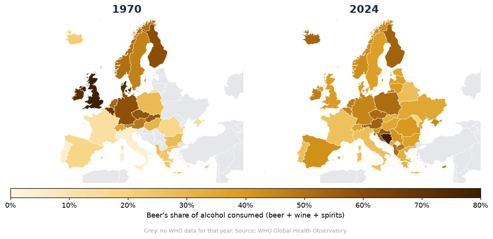
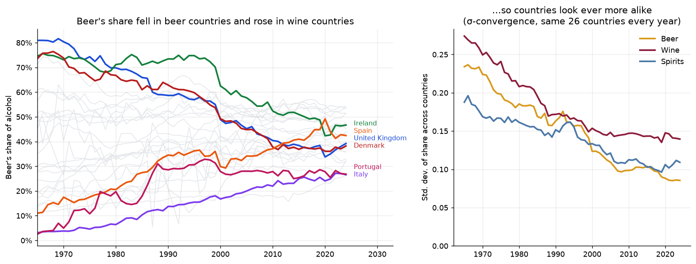
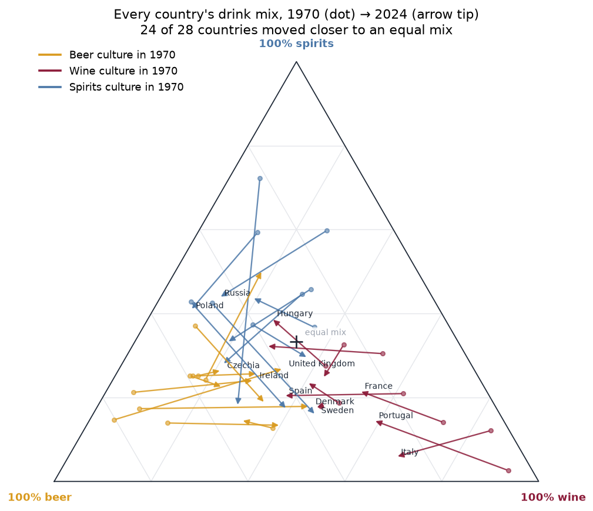
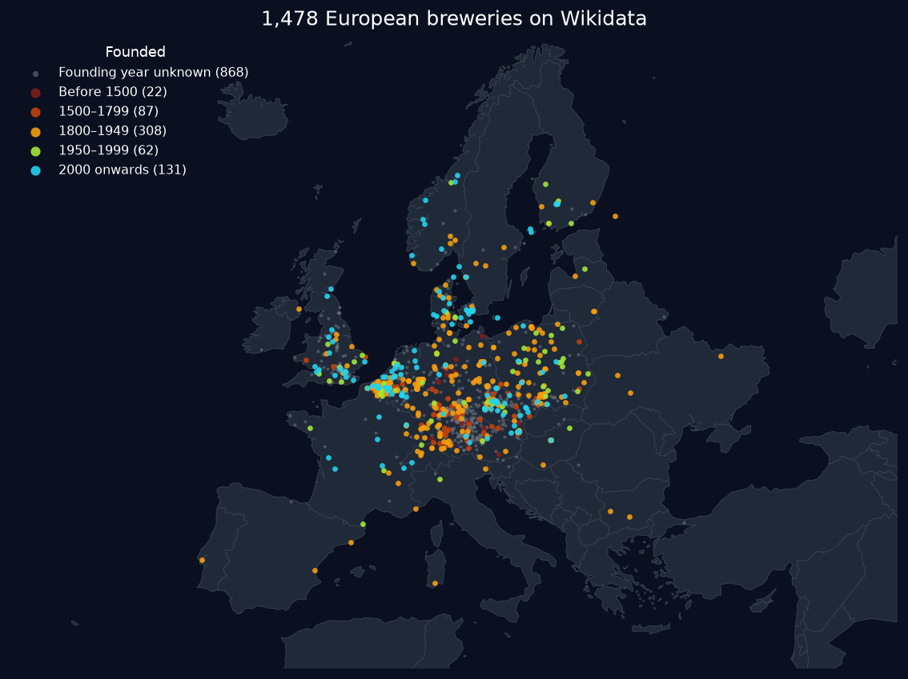
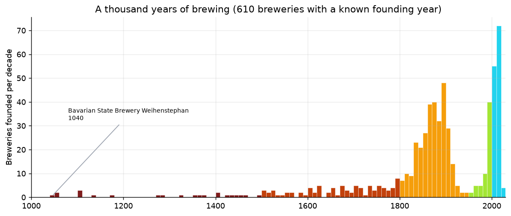
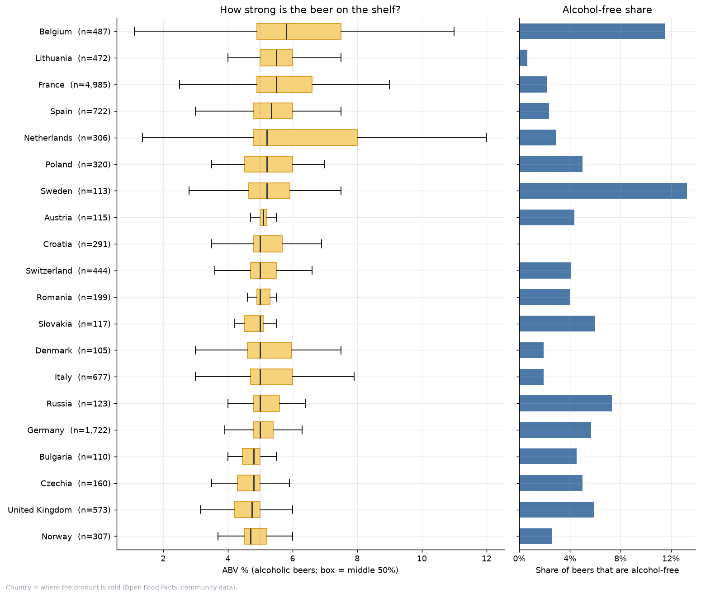
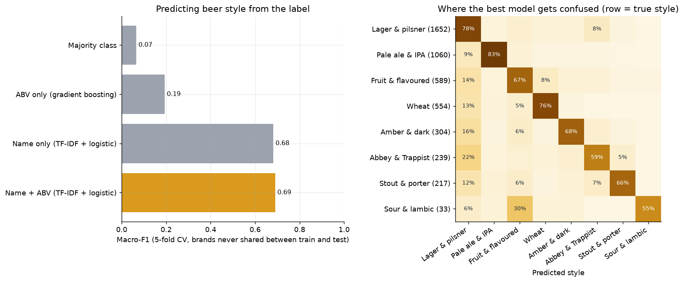

# Europe on Tap

How Europe drinks, where it brews, and what is on the shelf. A data science project built on public data: WHO alcohol statistics, Wikidata and Open Food Facts.



## Questions

1. **Drinking cultures.** Europe used to split cleanly into beer, wine and spirits countries. Is that still true?
2. **Brewing heritage.** Where are Europe's breweries, and when were they founded?
3. **On the shelf.** How strong is the beer sold in each country, and can a model tell a beer's style from its name?

## 1. Drinking cultures are converging

Data: WHO Global Health Observatory, recorded alcohol per adult (15+) in litres of pure alcohol, split by beer, wine and spirits. It covers 41 European countries from 1960 to 2024; 28 of them already have data for 1970. Each drink's *share* is computed over beer + wine + spirits.



The traditional beer countries now get a much smaller part of their alcohol from beer, and the wine countries a much larger one:

| Country | Beer share 1970 | Beer share 2024 |
|---|---|---|
| United Kingdom | 80% | 39% |
| Ireland | 73% | 47% |
| Denmark | 74% | 38% |
| Spain | 18% | 42% |
| Italy | 4% | 27% |
| Portugal | 5% | 27% |

Two standard convergence tests confirm the pattern:

- **Sigma-convergence:** over the same 26 countries every year, the standard deviation of beer's share fell from 0.234 (1965) to 0.086 (2024), and wine's from 0.274 to 0.140.
- **Beta-convergence:** regressing the 1970→2024 change in share on the 1970 level (n = 28) gives a strongly negative slope for every drink. Countries that started high fell the most:

| Share | Slope | R² | p-value |
|---|---|---|---|
| Beer | −0.861 | 0.848 | 4e-12 |
| Wine | −0.686 | 0.677 | 7.6e-08 |
| Spirits | −0.743 | 0.611 | 9e-07 |

K-means (k = 3) on the three shares, fitted on 1970 and 2024 together, recovers a beer, a wine and a spirits cluster. The ternary plot shows every country's move between the two years:



24 of the 28 countries moved closer to an equal mix of the three drinks. 11 countries changed cluster; for example, Spain moved from the wine cluster to the beer cluster, and Denmark from beer to wine.

Beer is still the most common main drink. It was the largest of the three in 13 of 28 countries in 1970 and 20 of 41 in 2024. The heaviest beer drinkers in 2024 were Czechia (6.5 litres of pure alcohol from beer per adult), Austria (6.1) and Croatia (5.7).

## 2. A thousand years of brewing

Data: every item on Wikidata that is a brewery (or a subclass of one), has coordinates and is in a European country. That gives 1,478 breweries. The top countries are Germany (541), Belgium (234), Czechia (144), the United Kingdom (121) and Poland (108).



610 breweries have a founding year. The oldest are Bavarian monastery breweries: Weihenstephan (1040), Tegernsee (1050) and Weltenburg (1050). Foundings peak twice: in the late 19th century (186 founded 1850–1899) and in the craft-beer wave since 2000 (131).



## 3. On the shelf

Data: every product in the Open Food Facts "beers" category, filtered out of the full export (about 1.5 GB compressed). That gives 12,789 beers, 4,815 of them with a usable ABV (values outside 0–20% are dropped as errors). A product counts for a country if it is *sold* there, and only countries with at least 100 products are shown.



- **Strength:** the median alcoholic beer sits between 4.7% and 5.8% ABV in every country shown. Norway (4.7%), the United Kingdom (4.75%) and Czechia (4.8%) are at the low end; Belgium (5.8%), France and Lithuania (5.5% each) at the high end.
- **Strong beers:** Belgium (30% of alcoholic beers at 7% ABV or more) and the Netherlands (28%) stand out. Czechia has under 2%.
- **Alcohol-free:** Sweden (13%) and Belgium (12%) have the largest share of alcohol-free products. Lithuania has under 1%, and Croatia has none in the data.

### Can a model tell the style from the label?

Styles come from the products' category tags. There are 4,648 labelled beers in 8 groups, from Lager & pilsner (1,652) down to Sour & lambic (33); alcohol-free products are left out. The model reads the product name (TF-IDF on words and character n-grams) and the ABV, and feeds both into a class-balanced logistic regression.

Evaluation is 5-fold cross-validation **grouped by brand** (1,759 brands). The model is never tested on a brand it saw in training, so it can't score by memorising brand names.



| Model | Macro-F1 | Accuracy |
|---|---|---|
| Majority class | 0.066 | 0.355 |
| ABV only (gradient boosting) | 0.193 | 0.259 |
| Name only | 0.682 | 0.746 |
| Name + ABV | 0.690 | 0.752 |

The name does almost all the work; adding ABV lifts macro-F1 by only 0.008. The most common error is predicting "Lager & pilsner" for other styles (22% of Abbey & Trappist beers, for example). Sour & lambic, the smallest group, is often mistaken for Fruit & flavoured (30%). The two groups overlap: fruit lambics such as kriek can carry both tags, and the labelling rules put them under Fruit.

## Limitations

- WHO figures are *recorded* consumption (sales and production). Home brewing, cross-border shopping and tourism are not counted.
- Shares leave out the WHO "other" category (cider, fermented drinks and so on).
- Wikidata coverage is uneven. Germany and Belgium are documented far better than Southern and Eastern Europe, so the map shows where breweries are *recorded*, not where they all are. Most entries (868 of 1,478) have no founding year.
- Some early founding dates on Wikidata belong to the monastery that later housed the brewery rather than to the brewery itself.
- Open Food Facts is crowd-sourced. It is weighted heavily toward France (4,985 of the beers are sold there), ABV is missing for most products, and styles depend on how contributors tagged each product. The shelf figures describe this database, not a full market survey.

## Run it

```bash
git clone https://github.com/Wannkw/europe-on-tap.git
cd europe-on-tap
python -m venv .venv
source .venv/bin/activate        # Windows: .venv\Scripts\activate
pip install -r requirements.txt

python scripts/run_pipeline.py --skip-shelf   # parts 1-2, small downloads
python scripts/run_pipeline.py                # all parts, downloads ~1.5 GB once (can take hours)
pytest -q
```

The numbers in this README come from data downloaded on 17 November 2026. WHO, Wikidata and Open Food Facts are all updated over time, so a fresh run can give slightly different counts. Downloads are cached in `data/`. Figures go to `reports/figures/` and the numbers quoted here to `reports/metrics.json`.

## Project structure

```
src/europe_on_tap/
  data.py       downloads and caching (WHO, Wikidata, Open Food Facts, Natural Earth)
  drinking.py   convergence tests, dominant drink, k-means drinking cultures
  geo.py        Lambert equal-area projection and country polygons (no GIS dependencies)
  shelf.py      beer style labels, per-country summary, style classifier
  plots.py      all figures
scripts/run_pipeline.py
tests/
reports/        figures and metrics.json
```

## Data sources

- **WHO:** World Health Organization. *Alcohol, recorded per capita (15+) consumption (in litres of pure alcohol), by beverage type* (indicator SA_0000001400). Global Health Observatory, https://www.who.int/data/gho, accessed 17 November 2026. Data provided by WHO Member States.
- **Open Food Facts:** Contains information from Open Food Facts (https://world.openfoodfacts.org), made available under the [Open Database License (ODbL)](https://opendatacommons.org/licenses/odbl/1-0/). The beer extract used here is not stored in this repository; it can be rebuilt from the public export with [`src/europe_on_tap/data.py`](src/europe_on_tap/data.py).
- **Wikidata:** brewery data, public domain (CC0), https://www.wikidata.org
- **Natural Earth:** country boundaries, public domain, https://www.naturalearthdata.com

This project is not affiliated with or endorsed by WHO or Open Food Facts.
